<div align="center">

<br/>

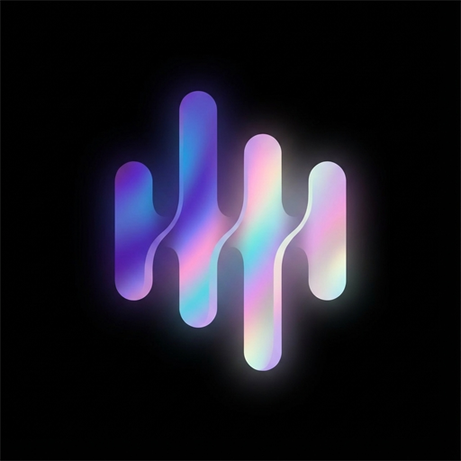

# Vikify

### A Modern, Premium Music Player for Android

<br/>

[](https://github.com/TheCraftsman1/vikify/releases)
[](https://github.com/TheCraftsman1/vikify/blob/main/LICENSE)
[](https://github.com/TheCraftsman1/vikify/releases)

<br/>

[**Download**](#download) · [**Features**](#features) · [**Screenshots**](#screenshots) · [**Building**](#building) · [**License**](#license)

<br/>

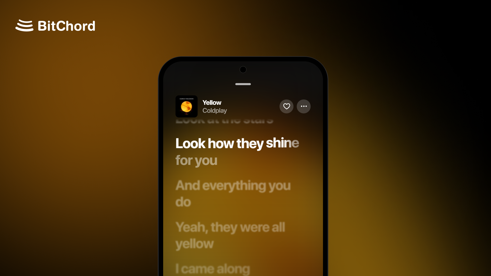

</div>

> [!IMPORTANT]
> Vikify is an independent third-party client and is not affiliated with, endorsed by, or connected to YouTube, Spotify, or Google LLC in any way.

---

<div align="center">

<h1><a id="features"></a>Features</h1>

<table>
  <tr>
    <td width="50%" valign="top">

### 🎧 Hybrid Music Library
- **YouTube Music Streaming** — Stream and explore songs, albums, artists, and community playlists.
- **Unified Library** — Seamlessly combine YouTube Music, local audio files, and imported Spotify tracks in one place.
- **Offline Mode** — Download songs with embedded metadata for high-quality offline listening.
- **Local Audio** — Scan and manage local files with metadata and artwork support.

### 🤖 AI DJ Mixes & Live Studio
- **Personalized DJ Flows** — Auto-generated mixes (*Your Flow*, *Chill Vibes*, *Energy Boost*) based on your listening energy.
- **Interactive AI Companion** — Chat with the in-app AI DJ to discover new tracks and craft curated lineups.
- **DJ Transitions** — Smooth pacing, beat-matching, and adjustable crossfade.

    </td>
    <td width="50%" valign="top">

### 🔄 Spotify Integration
- **One-Click Import** — Connect your Spotify account to mirror your playlists and Liked Songs.
- **Background Matching** — Automatically resolves Spotify tracks to high-quality audio streams.

### 👥 Party Rooms (Listen Together)
- **Synchronized Group Listening** — Host or join real-time party rooms powered by Firebase.
- **Shareable Links** — Invite friends with deep links to listen to the same queue simultaneously.

### 🎨 Glassmorphic Material 3 UI
- **Dynamic Theming** — Material color palette dynamically extracted from current album art.
- **Frosted Glass Design** — Translucent navigation bars and floating mini-player via Haze.
- **Synced Lyrics** — Word-level and time-synced animated lyrics powered by LRCLIB and Kugou.
- **Listening Stats & Replay** — Track playback statistics with encrypted cloud sync.

    </td>
  </tr>
</table>

</div>

---

<div align="center">

<h1><a id="screenshots"></a>Screenshots & Showcase</h1>

<p align="center">
  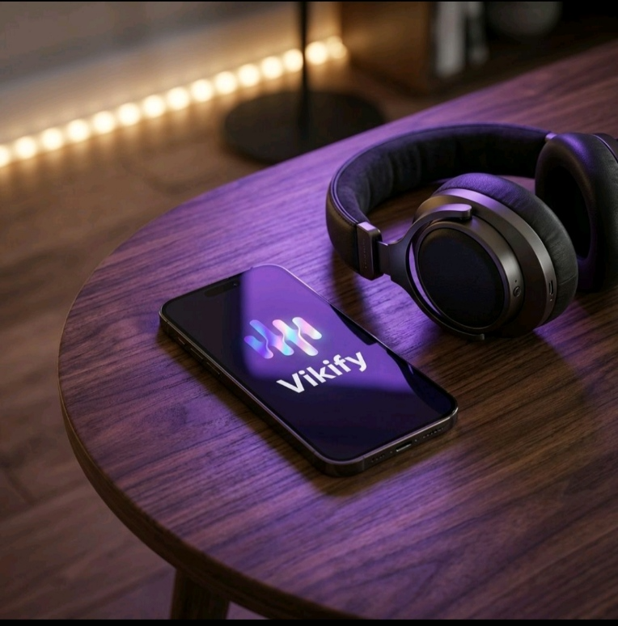
</p>

### 📱 Core Navigation & Library

<p align="center">
  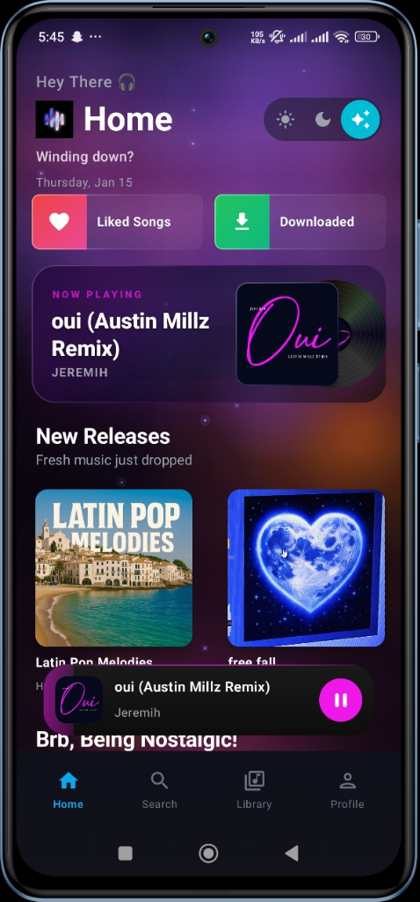
  &nbsp;&nbsp;
  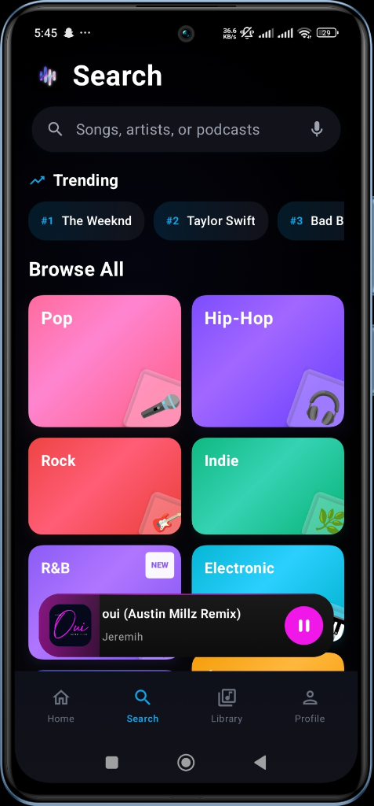
  &nbsp;&nbsp;
  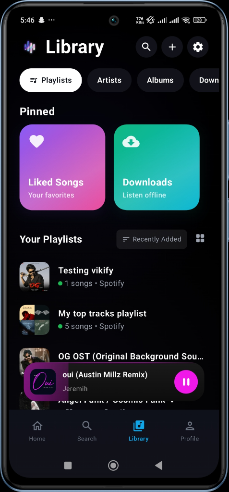
  &nbsp;&nbsp;
  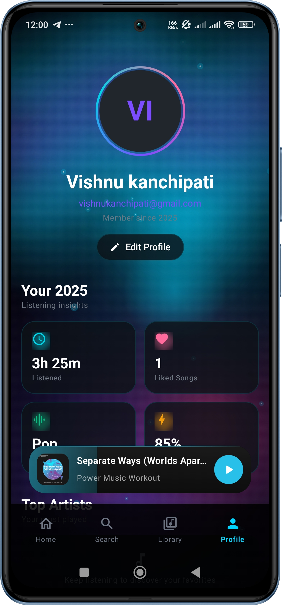
</p>

### 🤖 AI DJ Studio & Party Listening

<p align="center">
  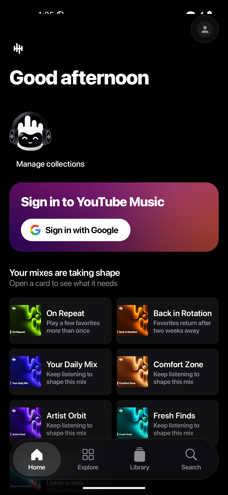
  &nbsp;&nbsp;
  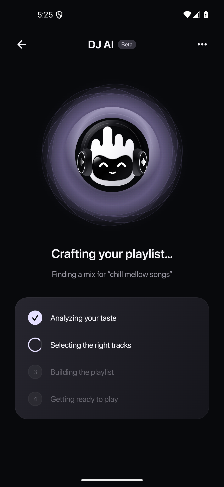
  &nbsp;&nbsp;
  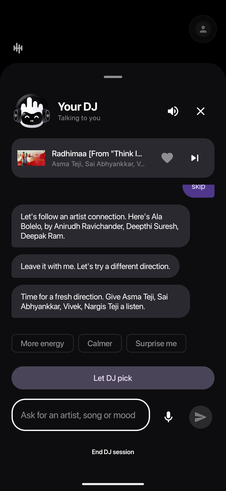
  &nbsp;&nbsp;
  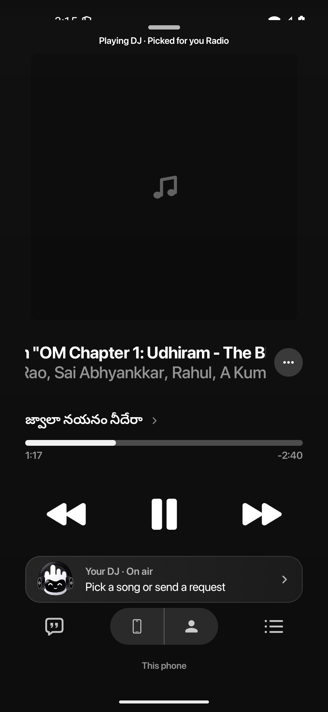
</p>

### 🚀 Highlights & Integrations

<p align="center">
  
  &nbsp;
  
</p>
<p align="center">
  
  &nbsp;
  
</p>

</div>

---

<div align="center">

<h1><a id="download"></a>Download</h1>

<a href="https://github.com/TheCraftsman1/vikify/releases" target="_blank" rel="noopener noreferrer"></a>

<br/><br/>

### 📦 Latest Official Release: **Vikify v2.0.2**

| Package | Architecture | Size | Download |
| :--- | :--- | :--- | :--- |
| **Vikify-2.0.2.apk** | Universal (ARM64 / ARMv7 / x86_64) | ~52.4 MB | [⬇️ Download APK](https://github.com/TheCraftsman1/vikify/releases/download/v2.0.2/Vikify-2.0.2.apk) |
| **Vikify-2.0.2-source.zip** | GPLv3 Corresponding Source | ~29.5 MB | [⬇️ Download Source](https://github.com/TheCraftsman1/vikify/releases/download/v2.0.2/Vikify-2.0.2-source.zip) |

> **SHA-256 (APK):** `4D5D6C39158C05A068D2A8309392197A40569B29760ED977280BA9EB7573ADF6`  
> *Sideloading requires enabling "Install unknown apps" in Android settings for your browser or file manager.*

</div>

---

<div align="center">

<h1><a id="building"></a>Building from Source</h1>

</div>

### Prerequisites
- Android Studio Ladybug or newer
- JDK 17 or JDK 21
- Android SDK 35 / 36

### Build Steps
```bash
# Clone the repository
git clone https://github.com/TheCraftsman1/vikify.git
cd vikify

# Assemble release APK
./gradlew :app:assembleProdRelease
```

---

<div align="center">

<h1><a id="license"></a>License</h1>

This project is licensed under the **GNU General Public License v3.0 (GPLv3)**. See the [LICENSE](LICENSE) file for details.

---

<p align="center">
  Made with ❤️ by TheCraftsman1
</p>

</div>
