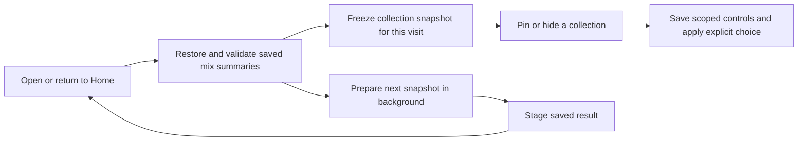
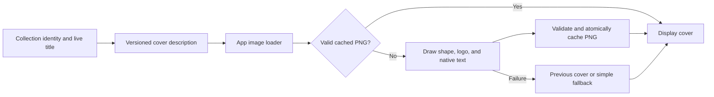

# Personalized Music Home implementation progress

Updated 31 October 2026

## First milestone implemented

The Android app now generates On Repeat, Back in Rotation, and Your Daily Mix from existing listening evidence recorded on the device. The existing Home cards open these generated collections through their current mood routes.

On Repeat requires at least two dated meaningful plays within the last 28 calendar days. It ranks those plays with a 14 day decay half life. Undated historical totals do not become invented recent plays.

Back in Rotation requires at least three historical meaningful plays and at least 14 days since the track was last played. It combines historical frequency with the length of the listening gap.

Your Daily Mix ranks familiar tracks from device history and uses up to two distinct artist seeds for related catalog candidates. It interleaves familiar and unheard tracks, removes duplicate identities, spreads artists, and caps the result at 30 tracks. It can create a familiar selection without a network connection. If related retrieval fails during a refresh and a previous daily version exists, that version is retained.

## Persistence and presentation

- Generated mixes use a dedicated local store with account and profile separated cache keys.
- The active snapshot is written through a temporary file and atomically replaced before publication.
- Cached tracks appear on a collection page before regeneration completes.
- A previous snapshot remains readable during refresh and survives failed or empty refreshes.
- Opening a collection checks its freshness. On Repeat and Daily Mix use a daily policy; Back in Rotation uses a weekly policy.
- Collection pages expose Refresh mix, a listening explanation, and the last update time.
- Insufficient evidence produces a specific listening guidance message instead of generic search results labeled as personal music.
- Account changes cancel obsolete page loads and reject results belonging to another scope.
- Generation does not change an active playback queue.

## Integration points

The shared Kotlin module contains `LocalMixGenerator`, `GeneratedMixRepository`, and their data contracts. The Android adapter reads a detached snapshot of current and historical Replay track evidence. Existing Replay totals and files retain their schema and ownership.

`MoodGenreRepository` delegates the first three collections to the installed local repository. `MainViewModel` handles cached presentation, refresh state, and account guards. The existing detail screen displays the explanation and refresh control. Startup installs the Android adapter after listening statistics are initialized.

## Validation completed

- All 96 shared JVM tests passed, including 24 new personalization tests.
- Eight focused Android unit tests passed, including two new evidence adapter tests and six existing queue history tests.
- Android compilation and `assembleDevDebug` succeeded.
- The development build includes arm64, armeabi v7a, x86 64, and universal APK outputs under `app/build/outputs/apk/dev/debug`.
- The connected emulator reported offline, so visual and interactive checks on a running device remain outstanding.

The tests cover selection rules, dated versus undated history, artist variety, duplicate removal, persistent metadata, restart recovery, expired snapshots, failed refresh retention, account cache isolation, cancellation, concurrent generation, and reading a previous snapshot during refresh.

## Second milestone implemented

Recommendation sessions now have an independent identity tied to the queue entry and listener scope. The collector uses a monotonic clock for elapsed listening and retains one logical session across pauses, buffering, and same-entry source replacements. Checkpoints preserve a conservative union of observed media intervals, so seeking forward cannot masquerade as listening and replaying a segment does not inflate unique coverage.

The player integration attributes explicit Next and Previous commands, queue selections, and restarts through the existing session player. Automatic repeats remain separate from intentional restarts. Source failures, stops, account changes, and unmarked queue replacements have neutral end reasons. Replay totals continue to be recorded by the existing recorder; the session collector never adds another copy of those plays.

Session evidence contributes capped intentional replay and completion bonuses, a modest early skip penalty, and distinct listening day evidence. Early skips are weak evidence and do not exclude a song. Short songs with substantial coverage are not treated as early rejections simply because they last less than 30 seconds. Completion signals require a natural end and at least 85 percent observed unique coverage.

The song menu now offers local recommendation controls to recommend a track more, undo that boost, hide it from personal mixes, and allow it again. These controls are available without a provider sign-in and affect the three local personalized mixes. They are separate from provider library ratings. Feedback survives restart and stays isolated by account and profile.

Feedback changes invalidate mix freshness independently of its normal expiry. Exclusions filter cached versions, retained versions after failed refreshes, and catalog results before publication. An exclusion also removes the song from open generated collection pages without editing the playing queue. If every candidate is hidden, the page explains that preferences must change or other music must be found.

The evidence store keeps at most 2000 session records per listener scope and prunes records older than 90 days when recording new checkpoints. Upserts use the session identity and a monotonically increasing revision, so late checkpoint writes cannot overwrite a newer finished session. Evidence and feedback use atomic local file replacement. Corrupt evidence is preserved for recovery rather than silently replaced with an empty profile.

### Second milestone verification

- All 121 shared JVM tests passed, including session state transitions, seek coverage, repeated sections, account isolation, checkpoint deduplication, retention, explicit preferences, and cached exclusion behavior.
- Nine focused Android unit tests passed, including the evidence adapter, preservation of Replay counts, session feature extraction, and existing queue history checks.
- Android development compilation and APK packaging are verified for this milestone.
- The available emulator still reports offline, so live playback and visual interaction checks remain outstanding.

## Third milestone implemented

All seven core collection identities now use the local personalization repository on Android. The four new generators share the existing cache, refresh controls, account guards, and reversible track feedback. Their existing artwork and routes are retained.

| Collection | Selection behavior | Freshness |
| --- | --- | --- |
| Comfort Zone | At least four familiar favorites for each optional unheard track from a favorite artist; sparse history produces a shorter familiar mix | Three days |
| Artist Orbit | Builds around up to two favorite artist seeds, ranks unheard work and deeper cuts, and permits related artists from those seeds | One week |
| Fresh Finds | Removes every identity with a recorded meaningful play; ranks catalog tracks connected to personal seeds and caps each artist at three tracks | One week |
| Beyond the Usual | Requires developing preference confidence, excludes the dominant artist rotation, and selects related unheard tracks with a two track artist cap | One week |

Each generator caps a selection at 30 tracks. It does not fill missing places with generic search results. Unheard means outside the available device listening evidence, rather than a newly released song.

### Preference profile and confidence

`TasteProfileBuilder` derives normalized long term and recent track and artist affinities from valid evidence. Recent affinity uses the last 28 calendar days with a 14 day decay half life. Artist credit is shared across known collaborators. Stable artist IDs take priority; unambiguous name aliases connect legacy evidence, while conflicting known IDs remain separate. Explicit track exclusions remove that evidence from learned affinity. A positive track preference can promote a favorite artist without redefining which artists dominate the history.

Confidence describes evidence breadth, rather than the probability that a listener will like a song. Its initial settings are:

- No valid learning evidence: no preference confidence.
- Fewer independent songs or days: still learning, even when one track has hundreds of plays.
- At least two dated tracks, two distinct days, and four dated meaningful plays: developing.
- At least five dated tracks, three distinct days, and twelve dated meaningful plays: established. Individual artist confidence uses three tracks and eight plays for the established threshold.

Confidence uses a 90 day evidence window and unions actual calendar dates across tracks and recommendation sessions. Undated totals can support affinity but cannot invent dated plays or listening days. Future timestamps do not teach preferences. All eligible positive play identities, including undated history, remain known heard tracks for discovery exclusions.

Generated snapshots persist their confidence level and, for Artist Orbit, the artist names that explain its selection. Collection pages show this explanation and confidence alongside the update time. The algorithm version is now 3; earlier saved versions remain readable while replacement is attempted.

### Retrieval and saved discovery behavior

Candidate retrieval keeps the personal seed and its source with each result. New generators reject candidates without a supported learning seed. Artist Orbit can use a bounded artist landing page request as well as related tracks, without fetching full discographies. Retrieval uses at most three seeds, four requests per generation, two simultaneous catalog calls, and 75 records per response. Requests have individual and overall time limits.

Fresh Finds and Beyond the Usual recheck current history before returning saved versions, even before normal expiry. Newly heard tracks disappear from those saved selections. Beyond the Usual also removes an artist that has become part of the dominant rotation. When more than half a discovery snapshot has become ineligible, opening the collection attempts to refill it.

A successful empty catalog response produces a no suitable discoveries message. An unavailable catalog produces a refresh failure message. Insufficient learning history and explicit exclusions retain their separate guidance. Failed refreshes preserve a still eligible previous selection, and feedback arriving during retrieval is applied before publication. These operations preserve the active playing queue.

### Third milestone verification

- All 148 shared JVM tests passed, including 27 new checks for confidence breadth, artist identity, distinct collection membership, sparse history ratios, candidate provenance, diversity caps, hidden songs, bounded catalog concurrency, restart metadata, and changing discovery eligibility.
- Ten focused Android unit tests passed, including exact session calendar dates without adding Replay plays and the existing queue history checks.
- Android development compilation and APK packaging succeeded, including the universal APK and the three architecture specific outputs.
- The connected emulator still reports offline. Live playback and visual interaction checks remain outstanding.

## Fourth milestone implemented

Android Home now composes collection shelves from listener scoped summaries instead of always promoting the same static cards. The compact two column collection layout and existing cover assets remain in use, with a short reason below each title.

| Home area | Behavior |
| --- | --- |
| Pinned collections | Explicit listener choices, in pin order, ahead of adaptive collections |
| Made For You | Only core mixes with an actual usable saved track version |
| Your mixes are taking shape | Guidance for insufficient history, missing discoveries, exclusions, or a retry |
| Other collection shelves | Existing curated collections, labeled as curated and without duplicate core mix cards |

A pinned mix that is not ready keeps its listening guidance. Pinning does not invent playable tracks. The unsupported Time Capsule generator remains a curated collection rather than being promoted as a generated personal mix.

### Stable visit boundaries

`AdaptiveHomeRepository` restores saved summaries and verifies the underlying generated snapshots without catalog requests. It prepares the next feed in the background using the existing mix freshness policies. A summary alone cannot make a missing or newly ineligible mix appear ready.

`HomeVisitSession` keeps the displayed collection snapshot fixed during a Home visit. Prepared results are staged for the next visit rather than moving the current cards. Returning to Home, resuming the app on Home, or requesting refresh establishes a new visit. Explicit refresh can adopt the prepared result. Ordinary server shelf responses and pagination reuse the frozen collection snapshot. Explicit pin and hide actions apply immediately.

The initial adaptive rank combines collection purpose, confidence, freshness, and local collection selections. Visible impressions without a selection supply only a small, capped penalty. Once an order is saved, each preparation can improve at most one adjacent pair; newly eligible collections append to the existing order. Pins override this adaptive order in their own area.

### Collection controls and exposure summaries

Home exposes Manage collections, and holding a collection opens its controls. All 29 current collection identities can be pinned, unpinned, hidden, or shown again. Hidden collections can always be restored through Manage collections. Hiding removes a pin; pinning a hidden collection makes it visible. An idempotent pin preserves its previous position. Choices survive restart and stay isolated by account and profile.

Grid card impressions require at least half the card to remain inside the unobscured scrolling viewport for one second. Timers stop when the card leaves view, Home leaves the screen, the app pauses or loses window focus, or collection controls, song and browse menus, onboarding, Replay stories, or the player cover Home. Counts are deduplicated per collection and Home visit. A card selection also proves an impression, so fast taps do not create selections without a denominator. These are local Home selections, not proof that the collection produced satisfying listening.

`HomeCollectionStore` keeps daily impression and selection counts for at most 90 days. It retains at most 32 recent visit deduplication records within seven days. Preferences, summaries, and counts use an account hashed file and atomic replacement. Concurrent collection preparation, explicit controls, and metrics updates merge under the same store lock. Unreadable controls are preserved and produce a retry state instead of silently clearing hidden choices or pins. No quality summaries are sent to a server.

The controls show readable state text and collection specific accessibility labels. Card text can grow vertically at larger text sizes. Account changes cancel obsolete Home preparation, clear displayed scoped state, and reject stale results. A delayed cache read cannot undo a pin or hide action submitted while it was reading. These changes do not edit Replay history, saved playlists, or the current playback queue.

### Fourth milestone verification

- All 175 shared JVM tests passed, including 27 new checks covering eligibility, distinct shelf membership, bounded reordering, visit stability, staged publication, restart recovery, pin order, hidden restoration, account isolation, selection denominators, exposure deduplication, retention, concurrent writes, corrupt preference preservation, and cancellation.
- Ten focused Android unit tests passed, retaining the listening evidence and queue history checks from the earlier milestones.
- Android development compilation and APK packaging succeeded for the universal and architecture specific outputs.
- The emulator still reports offline. Visual layout, large text, accessibility interaction, and the visibility timer require live device verification.

## Fifth implementation milestone: following, saved copies, and reset

The seven generated mix pages now expose separate Follow mix and Save a copy actions. These are local features available without provider sign-in. Following stores the collection identity in Library; saving creates an independent playlist snapshot on this device.

| Action | Ownership and behavior |
| --- | --- |
| Follow mix | Keeps the changing mix in a Followed mixes Library shelf; opening it resolves the current generated version |
| Save a copy | Captures the visible song order and source version when the save dialog opens, then saves that chosen snapshot under an editable name |
| Clear personalization | Starts a new recommendation generation for the current account and profile and retires the previous generation's learning and controls |

Following is independent of Home pinning and visibility. A mix can be followed without being pinned, or hidden on Home while remaining in Library. Unfollow is reversible and does not delete a saved copy. Existing Home control records remain readable because the followed set defaults to empty.

### Independent saved playlists

Saved copies appear with the other on-device playlists in Library. Their pages support rename and confirmed deletion, and a song menu can remove a track from the copy. These edits do not change the source mix or another copy. Empty copies remain identifiable and can still be renamed or deleted.

`MixCopyStore` uses the account and profile identity independently of the recommendation generation. Copies therefore survive clearing personalization. They retain canonical track and credited artist metadata, source collection identity, source version, save time, and song order. Queue entry IDs, provider playlist entry IDs, and temporary player state are omitted. Refreshing or excluding songs from a generated mix never edits an existing saved copy.

The save dialog keeps a detached draft, so a refresh behind the dialog cannot silently replace the chosen songs. A write must succeed before the app reports success or publishes the copy in Library. UUID identities prevent two saves in the same millisecond from replacing one another. Each profile can keep up to 100 copies, each containing the generator's maximum of 30 tracks. They are playlists stored on the device, not downloaded audio, and are not uploaded to a provider or synchronized to another device.

### Reset without erasing Replay

Settings under Your data now offers Clear personalization with an in-app confirmation that identifies the affected data. It clears this profile's generated mix versions, recommendation sessions, song feedback, Home summaries and usage counts, pins, hidden collection choices, and followed identities. Replay history, saved copies, downloads, and the playing queue remain independent.

Deleting only the generated files would let old Replay totals rebuild the same preferences. `PersonalizationResetStore` therefore commits a new generation and listening cutoff before purging the retired generation. Existing users keep their original scope until the first reset. Subsequent resets use a new persisted generation, preventing a stale result from being mistaken for current work.

The boundary keeps hashed track keys and the daily counters needed to subtract plays already recorded on the reset day. It does not retain song titles, artist credits, or covers. After a reset, learning uses only positive dated play differences on or after the cutoff day, with activity after the cutoff time. Lifetime totals and undated history cannot reintroduce cleared affinity. The original Replay records are never modified. Discovery descriptions refer to recommendation history, since a reset deliberately stops using earlier device listening as learning evidence.

The reset coordinator serializes resets for one profile. Old checkpoint and control writers are retired under their store locks; generated work also checks the current generation before publication. In-flight refreshes cannot republish a cleared snapshot, and late player checkpoints cannot recreate deleted old-generation files. Finishing the recommendation tracker does not stop audio or reset Replay's recorder.

An atomic cleanup journal lists retired scopes until all their files have been removed. If removal is incomplete, the UI reports that recommendations were reset but old-file cleanup needs another attempt. Pending cleanup resumes on later app loading, including after process restart. A failed boundary commit leaves the previous profile intact. Unreadable reset metadata fails closed rather than silently enabling old listening again.

### Fifth milestone verification

- All 196 shared JVM tests passed, including 21 new checks for following independence, frozen copy order and metadata, duplicate save identities, copy edits, account isolation, failed writes, reset persistence, same-day play subtraction, later-day learning, undated history exclusion, retained copies, late writes, generation races, incomplete cleanup recovery, and failed reset commits.
- Ten focused Android unit tests passed, preserving the evidence adapter and queue history coverage.
- Android development compilation and APK packaging succeeded for the universal and architecture specific outputs.
- The emulator was offline at the previous milestone. A fresh availability check was blocked by automatic approval review because its usage limit was reached; the check was not executed. Live confirmation dialogs, Library navigation, saved-copy editing, and reset during real playback remain unverified.

## Sixth implementation milestone: reusable collection covers

Android can now construct collection artwork from reusable drawing instructions and live text. The prototype follows the dark frame, glossy shape, logo, bold title, and accent treatment in the existing cards. Its shapes are procedural native drawings; they are reference inspired rather than pixel identical reproductions of the original AI artwork. No title free source image was available, so this milestone adds no raster artwork to the app.

| Input | Implemented behavior |
| --- | --- |
| Composition | Glossy wave, Ribbon, or Orbit; a simple branded fallback is also available |
| Color | Lime, Violet, Teal, or Ember palettes |
| Title | Native Android text shaping, bounded to three lines, with English and Telugu preview presets |
| Output | 192, 480, or 720 pixel PNG, selected for the requesting view |
| Identity | Stable collection identity, title, locale, style, palette, variant, visual versions, size, and Android backend |

### In-app use and preview

Saved playlist copies now use a generated cover in Library and on their detail page. Their stable copy identity chooses a composition, color, and variant. Renaming a copy updates the title and cover identity. Changing its songs or source mix version does not repaint the cover. Existing saved records require no migration because the cover description is derived from their existing identity and title.

Settings under Appearance now includes Cover preview. It supports an editable title, English and Telugu presets, all three styles and four palettes, a full square preview, a compact Library style row, and a comparison with the bundled On Repeat card. Title rendering waits briefly while typing. The 29 existing fixed collection covers remain in use for their existing collections.

Telugu Melodies is an artwork prototype only. It does not claim to select Telugu songs. Language based collections still require explicit preferences and trusted track metadata before they can be introduced.

### Rendering and cache behavior

`CoverSpec` separates visual identity from playlist membership and generation time. Its private image URI travels through the same Coil image loader used by the app's artwork views. A custom URI fetcher requests a completed cover from `AndroidCoverEngine`; ordinary image URLs and bundled collection assets retain their existing handling.

The renderer draws off the main thread using native Canvas, gradients, reusable paths, the existing logo, and the app's bold font with system script fallback. Native line layout and actual glyph bounds align both English and Telugu titles. Long titles shrink within a bounded area and can use up to three lines. Intermediate rendering bitmaps are recycled after PNG encoding; the existing image loader manages displayed bitmap memory.

`CoverDiskCache` serializes generation and publishes validated images through atomic replacement. Cache keys include renderer, typography, template, palette, and logo versions, so visual changes invalidate old results. Completed PNGs are limited to 24 MB and 96 images with least recently used pruning. Cache validation checks dimensions and full decoding, rejecting truncated files that retain a valid PNG header. Failed rendering can retain the last valid cover for that collection and size. Missing styles use a simple branded fallback; unavailable disk storage falls back to an in-memory render. Clearing the image cache also clears composed covers.

### Sixth milestone verification

- All 212 shared JVM tests passed, including 16 cover checks for visual identity, Unicode round trips, stable playlist artwork, size selection, corrupt cache recovery, cancellation, concurrent requests, previous cover retention, bounded pruning, and restart reuse.
- Ten focused Android unit tests passed, preserving the listening evidence and queue history checks.
- Android development compilation and universal and architecture specific APK packaging succeeded.
- Six native Android tests passed on a fresh, isolated Android 15 / API 35 emulator, including a request through the real app image loader. They verify deterministic PNGs, native Telugu glyph fallback, bounded long titles, dimensions, missing-style fallback, cache reuse, rename invalidation, and repair of a truncated PNG. An initial run stopped during emulator process startup before tests began; the focused loader rerun and complete six-test rerun passed.
- Eighteen cover exports include all 12 style and palette combinations, English and Telugu titles, a long title, a fallback, compact sizes, and a side-by-side reference sheet in `output/cover-preview`.
- The running app's Settings preview was inspected with English and Telugu titles, Lime and Violet colors, and the full and compact cover views. Screenshots are saved beside the exports. This check caught and fixed a URI fetcher registration issue that direct renderer tests could not reveal; the new app image loader test guards that path.
- The universal development package is also available as `dist/Vikify-debug.apk`. Its packaged code includes the renderer, URI fetcher, and cover specification, and all 29 existing collection WebP assets are present.
- Physical phone performance, older Android versions, and broader accessibility interaction remain to be verified. The isolated artwork test does not establish live playback or the earlier milestones' account and reset interaction behavior.

## Remaining boundaries

The preexisting listening archive is device wide. Separating generated caches by account does not retroactively separate that historical evidence by account. The explanations therefore identify listening on this device as their source.

The adapter currently reconstructs YouTube track identities only. Replay records do not preserve the source references needed to reconstruct local file and other provider tracks safely. Those records remain available to Replay but are excluded from these initial generators.

The existing recorder still determines meaningful plays. Intentional replays, manual skips, unique coverage, and explicit feedback are now collected prospectively; they cannot be reconstructed accurately from old aggregate totals. Coverage deliberately underestimates unobserved segments. Receiver-side Cast audio is not included in the phone's elapsed audio sampling. Confidence thresholds require product evaluation with real listening. Language, mood, and activity preference profiles still require reliable metadata and attributable context.

Refreshes run when a collection opens, Home prepares its next snapshot, or the listener requests them. Persistent background scheduling remains a later stage. Following and saved copies are local to this device and profile. Clearing applies to the local mix system; it does not clear provider history, provider recommendations, or the cloud library. Home quality summaries currently measure visible grid exposures and collection page selections; attributable listening satisfaction and curated horizontal shelf impressions remain future measurement work.

The reusable cover renderer and Telugu Melodies artwork prototype are implemented. Reliable language and mood metadata remain outstanding. The current artist catalog source is a bounded landing page rather than a complete deep cut inventory, and related results remain subject to catalog availability and quality.

## Next implementation sequence

1. Add explicit language preferences and a trusted metadata contract, including unknown language handling, before introducing language claims into generated collections.
2. Connect eligible language collections to the reusable cover renderer and validate them with real listening evidence. Mood and activity collections require their own attributable metadata and context.

The complete product and engineering plan remains in `PERSONALIZED_MUSIC_HOME.md`.
