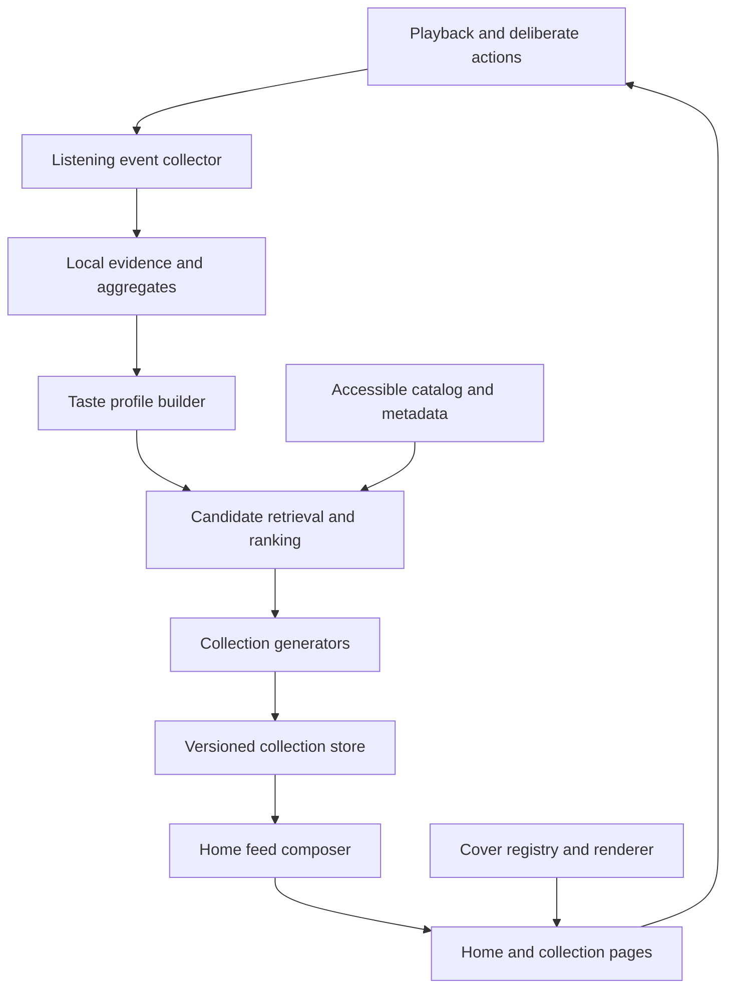
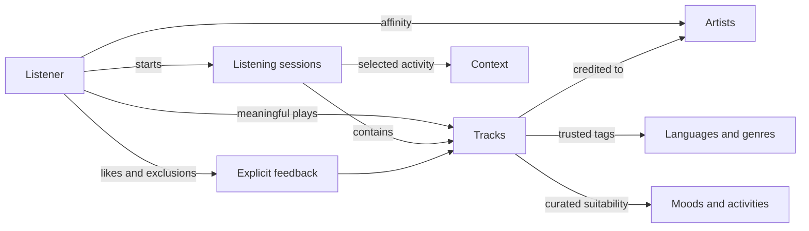
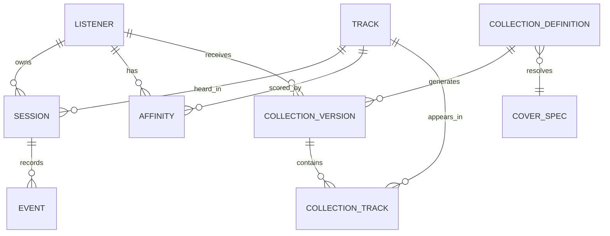
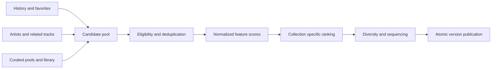
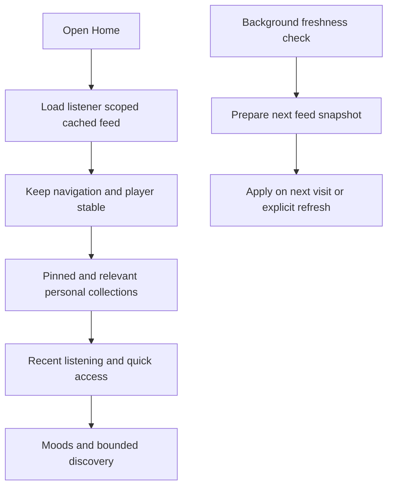
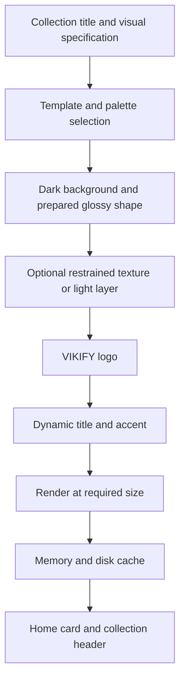
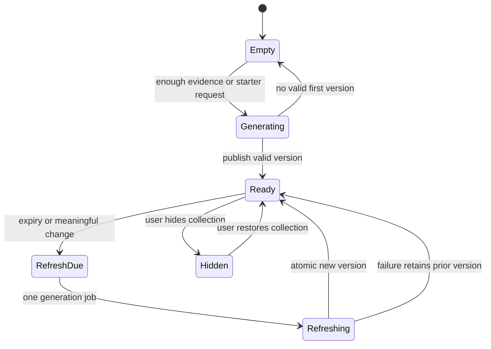
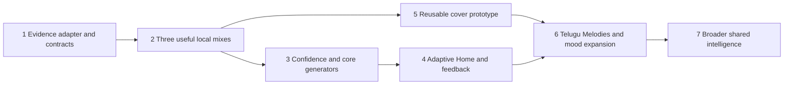

# VIKIFY Personalized Music Home Implementation Plan

Product behavior and engineering specification

31 October 2026

VIKIFY will use one shared understanding of listening preferences to generate useful music collections and decide which collections deserve space on Home. Existing collection artwork will retain its identity. Newly created collections, such as Telugu Melodies, will use a small library of reusable cover templates with titles composed inside the app.

The first release will run its personalization on the device and build on the player, listening statistics, navigation, catalog access, and Compose interface already present in the project. It will establish dependable repeat and rediscovery mixes before expanding into language collections, mood ranking, and discovery. More advanced models and server processing belong to later releases, after the product can measure whether they improve listening.

This document specifies the intended product, the data required to support it, the recommendation rules, the cover system, implementation boundaries, failure behavior, and release checks. It is a development plan. Proposed weights, refresh periods, retention periods, and performance budgets are initial settings to validate through implementation and measurement.

The architectural diagrams describe proposed relationships and data flows. They do not require a graph database. The central product rule is that a collection has a stable identity, while its generated track list, explanation, freshness, and Home position may change.

## 1 Product decisions and scope

Home should answer a practical question: what would this listener enjoy playing now? It should offer dependable favorites, opportunities to rediscover older music, and a manageable amount of discovery. A listener who prefers Telugu melodies should receive different songs from someone who prefers electronic music, even when both open Comfort Zone.

Two systems support that experience. The music system learns preferences, retrieves candidate songs, applies collection rules, and publishes a versioned playlist. The visual system resolves an existing cover or assembles a new cover from a reusable template. A change to the songs does not require a change to the cover.

The initial scope includes local preference storage, seven core personalized generators, a common mechanism for mood collections, collection ranking on Home, clear starter behavior, refresh and saving controls, and a reusable cover prototype. Existing playback and navigation remain the integration points. Account synchronization, collaborative filtering, model training, and generative naming services are later capabilities with separate prerequisites.

A collection should earn a claim of personalization. When listening evidence is weak, the app can show starter mixes based on explicit language and artist preferences. It should describe them as starter selections. A shorter, relevant mix is preferable to filling a promised track count with unrelated music.

Success means that the listener can understand a mix, start it quickly, find relevant playable songs, and influence future selections. A visually attractive grid alone does not demonstrate recommendation quality. Repeated use, substantial listening, saves, and explicit feedback provide stronger evidence.

### Product rules

- Keep stable collection identifiers even when a display title is localized or refined.
- Preserve the selected queue when a collection refreshes in the background.
- Keep pinned collections predictable and apply major Home reordering between visits.
- Use language, mood, and activity evidence with known provenance.
- Distinguish a new discovery from a new release. Unheard music may be old.
- Offer local control over preference collection, clearing history, and excluded sessions.
- Retrieve and rank actual catalog records. A generated title must not invent songs.

## 2 Current application and implementation gaps

The Android project already contains 29 collection definitions and 29 optimized WebP covers under `app/src/main/assets/moods`. `MoodGenreRepository` defines the collection catalog, fixed search queries, basic song filtering, and an in-memory song cache. Its existing collection IDs can anchor the new system.

The current Made For You component displays two columns of compact horizontal tiles with small square artwork. Other collection shelves use square artwork. The source conversation also proposes larger two-column artwork cards. Changing tile size is a separate visual decision; implementing personalized content does not require silently replacing the current layout.

Three collections currently take a basic personalized path. Your Daily Mix combines recent tracks with radio results from the latest seed. On Repeat selects the first 25 recent tracks. Back in Rotation drops the first four recent tracks and selects the next 25. These paths read account history through `YtMusicRepository.recents`; they do not yet use the app's richer local listening totals to distinguish repeated favorites from merely recent songs.

Most other collections use fixed search queries naming predetermined artists. That supplies music but can make a collection insensitive to the listener's language or taste. Home assembly also places the same main groups in a fixed order. The song cache is keyed by collection ID and has no explicit freshness policy in this repository.

`ListeningRecorder` already samples actual playback time. `ListeningStats` keeps monthly JSON aggregates, including track play counts, listening time, last play time, and daily detail. These are valuable foundations. They do not provide a complete historical event log for intentional replays, precise session completion, manual skips, or recommendation exposure. Those missing signals must begin accumulating prospectively.

| Existing component | Reuse | Required extension |
| --- | --- | --- |
| PlaybackService | Playback sampler and transition callbacks | Attribute user actions and end reasons |
| ListeningRecorder | Actual listening accumulation | Separate a listening session from temporary pauses and quality swaps |
| ListeningStats | Existing aggregates and historical favorites | Read adapter for personalization without rewriting Replay storage |
| MoodGenreRepository | Stable collection IDs and artwork registry | Delegate track selection to versioned generators |
| MainViewModel | Home state and collection navigation | Observe generated mixes and listener scoped updates |
| HomeScreen | Existing Compose cards and player indicators | Pins, relevance ordering, explanations, and empty states |
| Song model | Catalog identity and source references | Optional trusted language and suitability metadata |

Implementation must preserve existing user changes in the working tree. This plan does not require restructuring the repository or replacing the player.

## 3 System architecture and feedback loop

The system has a write path for listening evidence and a read path for recommendations. The write path records meaningful activity and updates compact aggregates. The read path uses a stable profile snapshot to generate collections. Keeping these paths separate prevents Home rendering from scanning raw events or performing heavy network work.



Figure 1. Proposed architecture. Listening feedback returns through the same collection path; artwork is resolved independently of track ranking.

The collector owns event meaning. It identifies the track, queue entry, session, action source, and playback outcome. Storage owns durable writes and migrations. The profile builder converts evidence into track, artist, language, and context preferences. Retrieval obtains a bounded candidate pool, while the ranker applies normalized scores and explicit feedback.

Collection generators define the listening purpose. On Repeat and Headspace can share retrieval and scoring primitives while requiring different eligibility and ranking rules. The collection store publishes immutable versions, and the Home composer chooses which collection summaries to present.

An interface between Android evidence storage and shared Kotlin recommendation logic preserves the existing multiplatform organization. Android adapters can read `ListeningStats`, schedule background work, and render platform artwork. Shared logic should accept plain data models and produce deterministic decisions so it can be verified without a running player.

Network responses and background calculations must carry the current listener identity and generation token. Results produced for a previous account or stale request must be discarded before publication. Collection and profile caches must include the listener scope; the same `on_repeat` ID can represent different music for different listeners.

## 4 Music taste graph and confidence

The taste graph is a conceptual model of relationships. A listener has evidence for tracks and artists; tracks have catalog relationships; sessions associate listening with explicit context. These relationships can be represented with ordinary records and score maps.



Figure 2. Conceptual music taste graph. An edge represents evidence or a catalog relationship, not proof of an emotion or activity.

Maintain three profiles. Long-term preference reflects persistent favorites over months. Recent preference reflects meaningful listening over a shorter rolling period. Context preference describes what the listener chooses during activities such as Focus or Workout. Selecting an activity supplies stronger context evidence than the clock alone.

Preference strength and confidence are separate values. Ten plays of one track may create strong track affinity while providing weak evidence about an entire genre. A single Telugu song does not establish a complete language preference. Explicitly choosing Telugu provides a clear preference, while the app still needs suitable songs to construct a Telugu collection.

Store evidence counts, distinct tracks, distinct listening days, last meaningful activity, and metadata coverage alongside a preference score. Repeated observations across independent sessions should raise confidence more than many automatic loops in one session. Keep an exploration allowance so existing preferences do not exclude all unfamiliar music.

Initial confidence thresholds are product settings to tune. A reasonable pilot could require several distinct tracks across multiple listening days before promoting an inferred language collection. Context specific collections should require explicit activity selection or repeated, corroborating behavior. If the requirement is not met, the app can ask for a preference or show a broader starter collection.

Historical aggregate imports can seed artist and track affinity, but their provenance must stay visible to the algorithm. Missing session reasons cannot be reconstructed from aggregate counts. Profile records should retain a schema version, algorithm version, evidence cutoff, and the reason a preference is eligible for use.

## 5 Listening events and session semantics

A listening session is one logical encounter with a queue entry. Use a unique session ID and the existing queue-entry identity. The same song appearing twice in a queue creates two encounters. A pause, buffering interval, stream quality swap, or source re-resolution should not automatically create another play or an intentional replay.

Use a monotonic clock to measure elapsed listening time and a wall clock timestamp for dates and recency. Accumulate time only while the player is actually presenting audio. Cap anomalous sampler gaps and persist checkpoints so process termination causes a bounded undercount. Android Media3 exposes player state and transition events that support this integration [S2].

The existing recorder resets its transient state when playback stops. Before extending it, define which interruptions end a recommendation session and which merely suspend it. A pause and resume within one queue entry should preserve the recommendation session. Count an intentional replay only when a deliberate replay command or a clearly attributed user restart occurs. Track repeat mode separately.

| Signal | Meaning | Interpretation rule |
| --- | --- | --- |
| Actual listening time | Audio presented to the listener | Exclude buffering, paused time, and seek distance |
| Meaningful play | Session crossed the product listening threshold | Count once per logical session |
| Completion | Portion of track heard | Use known duration and unique coverage where available |
| Manual skip | User deliberately moved to another entry | Keep reason and source; one skip is weak negative evidence |
| Intentional replay | User deliberately replayed a track | Distinguish from repeat mode and internal transitions |
| Like or save | Explicit positive action | Deduplicate action state; toggling must not inflate evidence |
| Not interested | Explicit exclusion or negative preference | Apply immediately to future generated selections |
| Collection start | Listener selected a music experience | Associate later sessions with collection version |
| Home impression | Card was actually visible | Record visibility exposure, not merely successful rendering |
| Playback failure | Source or network problem | Availability signal rather than musical dislike |

A proposed event payload contains `eventId`, `listenerScope`, `sessionId`, `queueEntryId`, `trackId`, `eventType`, `occurredAt`, `sourceSurface`, `collectionId`, `collectionVersion`, `reason`, and action specific values. Record the originating command where possible so a media item transition can be attributed correctly. Generate stable deduplication keys for events replayed after a crash.

Completion needs care. A listener can hear the first minute four times without hearing the whole song. Summed listening time divided by duration measures engagement but can overstate coverage. If unique coverage is unavailable, label the feature as listening ratio, cap it for ranking, and avoid claiming exact completion.

Existing listening totals should remain the source for Replay statistics. Personalization can consume an adapter over those totals plus its own bounded session records. This prevents duplicate writers from counting the same play twice.

## 6 Local storage and data relationships

Introduce a small personalization repository beside existing statistics. Keep `ListeningStats` monthly files intact. For the first three generators, an adapter over current aggregates plus a durable generated collection store is sufficient. Add a structured event store when richer session queries and feedback are introduced. SQLite through Room is a candidate Android implementation; select it after checking migrations and shared-module boundaries.



Figure 3. Proposed storage relationships. Versions and their ordered tracks are committed together; a collection definition has a stable identity across versions.

| Record | Important fields | Lifecycle |
| --- | --- | --- |
| Track metadata | Stable source ID, artist IDs, duration, optional tags, provenance | Update when trustworthy catalog detail changes |
| Listening session | Session ID, track, queue entry, heard time, coverage, end reason, source | Checkpoint during play and close once |
| Listening event | Event ID, session, action, timestamp, reason | Deduplicate and compact on a retention policy |
| Daily track evidence | Listener, date, track, meaningful plays, heard time, last play | Aggregate in the write path |
| Affinity | Listener, entity, recent score, long-term score, confidence | Rebuild from valid evidence snapshots |
| Context preference | Listener, selected activity, entity, evidence, confidence | Update from attributable sessions |
| Collection definition | ID, purpose, generator, cover, eligibility, refresh policy | Version with application configuration |
| Collection version | Listener, definition ID, version, profile version, generated time | Immutable after publication |
| Collection track | Collection version, track ID, position, score, explanation code | Retain with the collection version |
| Recommendation feedback | Listener, target, feedback type, created time | Persist until reversed or cleared |
| Home exposure | Feed version, visible card, visibility interval, action | Compact to local quality summaries |
| Cover specification | Template version, title, palette, composition, cache key | Invalidate when visual input changes |

Use a local listener scope even when signed out. Account switching must select an explicit personalization scope rather than silently mixing histories. Decide whether device listening is shared across accounts through an explicit setting. The initial default should isolate account-specific generated results and preserve anonymous local history separately.

A proposed raw event retention period is 90 days, with daily evidence retained longer for rediscovery. This is a starting policy, not a requirement to collect every player tick. Store meaningful checkpoints and actions; compact only after aggregates have been committed successfully. Clearing personalization must remove derived profiles, generated versions, feedback, and relevant cache entries. Keep Replay history controls separate unless the listener chooses to clear both.

## 7 Catalog access and metadata quality

Candidate generation must operate on music the application can access through its existing providers and local library. A source record needs a stable track identifier and a reference that the playback resolver understands. Discovery cannot promise songs outside the available catalog.

Start with historical favorites, liked tracks available to the app, known library tracks, and related-track or artist results from the existing catalog adapter. Search is one retrieval tool; a hardcoded artist search is not a complete personalization model. Bound each retrieval source, deduplicate candidates, and keep enough provenance to explain why a song entered the pool.

Language, genre, mood, BPM, and energy should be nullable metadata with a source and confidence. Prefer explicit catalog tags, maintained curated pools, and user preferences. A title keyword or artist nationality is weak evidence for a track's language. For instrumental focus music, use trusted suitability or vocal information; do not assume that every piano result is distraction free.

Availability changes over time. Apply inexpensive eligibility checks during generation: supported source, known removal state, usable identifier, explicit exclusions, and metadata constraints. Resolve the actual stream when playback needs it. Avoid opening a stream for every candidate merely to populate Home. Recent resolution failures can temporarily reduce availability confidence without permanently treating a track as disliked.

Preserve source-specific identities and map known equivalents only when there is evidence they represent the same recording. Normalize text as a secondary deduplication aid, taking care with live, acoustic, instrumental, remaster, and language versions. An explicit user selection of a specific version must remain playable as selected.

Review the current broad studio-track filter before reusing it everywhere. It removes videos, certain title keywords, and tracks outside a fixed duration range. A short song, long composition, live acoustic performance, or instrumental piece may be appropriate for a particular collection. Eligibility should be configurable by collection instead of applying one broad rule to all music.

Any provider integration needs a current capability and permission review before importing history or using provider content for new forms of profiling. This plan makes local VIKIFY evidence the default input and does not depend on Spotify recommendation endpoints or claims about a provider's current policy.

## 8 Recommendation pipeline and ranking

Use a bounded pipeline so recommendation generation has predictable work. Retrieve candidates from several sources, apply eligibility constraints, compute normalized features, rank for the collection's purpose, diversify, sequence, and publish a durable version.



Figure 4. Shared recommendation pipeline. Each generator supplies different constraints and weights over the same supported evidence.

Define affinity, recent interest, collection fit, and novelty on a common scale from zero to one. Apply penalties for explicit negative feedback, recent overexposure, and excessive repetition. Missing metadata must not silently become a positive match. Where a field is essential, exclude unknowns; where it is optional, reduce confidence and renormalize the available feature weights.

A starting score can be expressed as `0.35 affinity + 0.25 recent interest + 0.20 collection fit + 0.20 novelty - penalties`. These weights are proposed VIKIFY defaults, not a claim about another service. On Repeat should favor recent repeated engagement and assign little value to novelty. Fresh Finds should require unheard candidates and give discovery more weight.

Use time decay to lower the influence of old evidence gradually. A half-life describes how long it takes an observation's influence to halve. Pilot values might use a short window for current rotation and a longer window for enduring artist preference. Measure the effect before exposing more tuning controls to listeners.

### Worked ranking example

The following illustrative values compare two candidates for a balanced daily mix. They are invented to explain the rule, not measurements from a listener.

| Candidate | Affinity | Recent | Fit | Novelty | Penalty | Final score |
| --- | --- | --- | --- | --- | --- | --- |
| Familiar favorite | 0.90 | 0.80 | 0.90 | 0.10 | 0.05 | 0.665 |
| Related unheard track | 0.65 | 0.30 | 0.85 | 1.00 | 0.00 | 0.673 |

The discovery candidate narrowly ranks higher, but diversity rules can retain both. A single formula should not force every collection to produce the same order. Keep feature contributions with a recommendation explanation code so developers can inspect a surprising selection.

After scoring, apply artist caps, duplicate recording controls, and a configurable familiarity-to-discovery balance. Do not exclude all collaborations because a lead artist already appeared; use credited artist identities with explicit limits. Sequence for a coherent experience when trustworthy suitability data exists. Preserve ordinary shuffle and the listener's subsequent queue edits.

## 9 Core personalized collection generators

The first release should make the seven core identities musically distinct. Each generator accepts a profile snapshot, evidence cutoff, collection definition, and candidate sources. It returns ordered track references, explanation codes, a confidence level, and generation metadata.

### On Repeat

Use recent daily evidence to rank repeat frequency and meaningful listening, with an extra signal for deliberate replays and likes. Cap the contribution of automatic looping in one session. Subtract modest fatigue when a track has appeared excessively without positive engagement. Artist diversity can be lighter here because a listener may intentionally repeat one artist.

Require several meaningful plays or strong explicit evidence before calling a song a repeat favorite. If the listener has only recent history, show a recent listening collection or a starter state rather than presenting chronological recents as repeat analysis. Refresh roughly daily or after enough new evidence changes the result materially.

### Back in Rotation

Retrieve historically strong favorites, then prefer those with a meaningful gap since their last substantial listen. Exclude current heavy rotation and recently rejected songs. A song played once months ago is weak rediscovery evidence. The generator needs both historical affection and reduced recent exposure.

Use existing aggregates to seed this collection immediately where enough history exists. Avoid arbitrary recents offsets. Refresh about weekly and retain a stable version between refreshes so a returning listener can find the rediscovered songs.

### Your Daily Mix and Comfort Zone

Your Daily Mix combines dependable favorites with related discoveries in a configurable ratio. Rotate artist seeds across the profile instead of always seeding from the latest track. Respect preferred languages and feedback while allowing some exploration.

Comfort Zone places a higher weight on familiar music and close relationships. It should vary enough to avoid repeating the same short list every day. A listener's comfort may be Telugu film melodies, acoustic pop, or another style; fixed English artist queries should give way to preference-aware candidate sources.

### Artist Orbit

Choose artist seeds using long-term preference and recent movement. Retrieve deeper cuts, collaborations, and related artists where the provider supplies supported relationships. Keep an explicit minimum relevance threshold. Explain the mix through one or more actual seed artists without claiming unsupported sonic similarity.

### Fresh Finds and Beyond the Usual

Fresh Finds selects tracks without meaningful prior listening in VIKIFY, while respecting known imported evidence where its use is permitted. Unheard means unheard in the evidence available to the app. It does not mean newly released. Require a relationship to preferred artists, genres, languages, or suitable curated pools.

Beyond the Usual increases variety and exploration beyond dominant preferences. Keep a relevance floor and a bounded number of unfamiliar styles. These two generators should be verified against the same listener profile to demonstrate that discovery strength changes while explicit exclusions still hold.

## 10 Mood and activity collections

Mood collections represent a chosen listening experience. The app may recommend Heavy Heart, but it should not describe the listener as sad. An explicit activity choice is a useful input; a late hour is only a contextual hint. Allow listeners to dismiss a recommendation and keep their preferred collections pinned.

Suitable candidate pools are essential. Full Throttle should use trusted workout suitability, reliable energy metadata, or maintained pools. Headspace and Quiet Focus need low-distraction music suited to the listener. Drift to Sleep requires a consistent low-intensity pool and should avoid abrupt tracks selected merely because they share an artist.

The following 18 identities correspond to the main collection plan in the reference conversation. Refresh cadences are proposed defaults, subject to evidence and catalog availability.

| Collection | Musical purpose | Main evidence | Initial refresh |
| --- | --- | --- | --- |
| Artist Orbit | Explore favorite artists and related work | Artist affinity and supported relationships | Weekly |
| Back in Rotation | Rediscover established favorites | Historical affinity and recent absence | Weekly |
| Beyond the Usual | Broader personal discovery | Relevance floor and higher novelty | Weekly |
| Comfort Zone | Familiar and dependable listening | Long-term favorites and close candidates | Every few days |
| Fresh Finds | Unheard music fitting current taste | Novelty and related catalog candidates | Weekly |
| On Repeat | Current repeated favorites | Recent meaningful plays and replays | Daily |
| Daybreak | A preferred morning selection | Chosen style and optional time affinity | Daily or on use |
| Midnight Flow | Preferred late-night listening | Context evidence and suitable pools | Every few days |
| Full Throttle | Workout energy | Explicit activity and trustworthy suitability | On use or daily |
| Open Road | Travel and singalong listening | Selected activity, familiarity, variety | On use or weekly |
| Drift to Sleep | Consistent low-intensity music | Trusted sleep suitability | On use or weekly |
| Headspace | Focus or unwinding | Selected purpose and low distraction | On use or weekly |
| Cloud Nine | Uplifting music | Suitable tags and personal affinity | Every few days |
| Dreamscape | Atmospheric listening | Trusted atmospheric pools | Weekly |
| Healing Space | Gentle and reassuring music | Curated suitability and feedback | Weekly |
| Heavy Heart | Reflective and melancholic music | Chosen mood and suitable pools | Every few days |
| Main Character | Cinematic and dramatic music | Curated identity and personal taste | Weekly |
| Neon Drive | Synth, electronic, and rhythmic music | Genre fit and personal affinity | Weekly |

The application uses `dreamspaces` as its current ID and Dreamspaces as its title. Preserve that ID during migration even if a future display title uses Dreamscape. Daybreak similarly uses `day_break`. Display wording and persistent identity are separate concerns.

Start with curated pools and personalized ranking for these experiences. Detailed energy progression, vocal analysis, and exact mood inference require additional trustworthy metadata and validation. When coverage is insufficient, offer a broader relevant mix or keep the existing curated selection with an honest description.

## 11 Adaptive Home behavior

Home should preserve familiar access points while adapting its recommendations. Search, Library, navigation, recently played, and the mini-player remain predictable. Collection ordering can respond to preference, availability, repeated use, freshness, and variety.



Figure 5. Home composition and refresh behavior. A new feed snapshot should not move a card away from the listener's finger.

A feed composer consumes collection summaries rather than raw song lists. Each summary includes identity, title, cover reference, explanation, confidence, track count, freshness, pin state, and availability. A generated collection must have a usable version before Home promotes it as ready to play.

A starting card rank can combine collection affinity, recent engagement, freshness, context relevance, and diversity. Pinning overrides the adaptive order within the designated pinned area. Apply an exposure penalty carefully: a visible card with no selection is weak evidence, and an off-screen card supplies none.

Keep the current compact two-column layout as the integration baseline. A larger artwork-first grid can be evaluated as a separate design variation. Existing covers already contain a title, so avoid adding a second title directly over them. External text can still improve readability and accessibility, especially on small thumbnails.

For a new listener, offer optional language and artist choices with a skip path. For a returning listener, prefer cached collections immediately, then check freshness. For an offline listener, show cached collection details and distinguish tracks playable locally from those requiring a connection. A cached playlist does not imply downloaded audio.

Expose a concise reason such as Based on your recent repeat listening or Familiar songs you have not played lately. Avoid claims about measured mood, precise personal characteristics, or activity that the evidence does not support. Explain the collection at the level the listener needs; keep score internals out of normal product screens.

## 12 Collection pages and listener controls

Opening a card should lead to an actual playlist page with its supplied or generated cover, title, description, track count, freshness, Play and Shuffle controls, and an ordered song list. Reuse the existing `mood:` navigation route during migration and resolve the route to the listener's active collection version.

When the listener presses Play, capture a snapshot of the displayed version and its ordered tracks. A background refresh may publish a newer version, but it must not replace the playing queue. The collection page can show that a newer version is available and let the listener choose when to start it.

Follow this mix subscribes to future generated versions. Save a copy creates a normal playlist containing the current snapshot. These are different operations with different expectations. A saved copy should preserve its membership unless the listener edits it. Following a collection should preserve the collection identity as its tracks evolve.

Refresh mix should request a new candidate version while keeping the current version usable. Prevent repeated taps from starting duplicate work. If generation fails, retain the previous version and show a small, actionable status. If no previous version exists, offer retry or a relevant starter collection.

Feedback should be scoped and reversible. Not interested in this song excludes that song from future generated selections until reversed. Less from this artist lowers recommendation preference rather than removing the artist from the library. Hide this collection affects Home visibility. Pin this collection affects placement. These actions should not silently delete music or alter saved playlists.

Provide controls to pause personalization for a session, clear personalization evidence, edit language preferences, and review hidden collections or artist feedback. A session excluded from recommendations may still contribute to ordinary playback history only if the settings make that distinction clear.

Accessibility belongs in the first release. Read collection titles and status through accessible labels, preserve adequate contrast, support large text outside artwork, maintain usable touch targets, and identify unavailable tracks without relying only on color. A title baked into a bitmap cannot replace an accessible text label.

## 13 Reusable cover architecture

Retain existing branded covers for established collection identities. New collections use a small collection of title-free artwork templates. The supplied references include a green title-free background suitable for an initial composition prototype. Its lighting is already baked into the image, so arbitrary recoloring requires visual validation.



Figure 6. Cover composition. Song selection and cover rendering have separate cache keys and update independently.

Use a hybrid renderer first. Prepared artwork preserves the reference's dimensional glow and texture, while the application draws branding and typography. Simple gradients and vector paths can provide additional compositions, but matching the glossy reference exactly requires a visual comparison rather than an assumption that a few paths reproduce the same result.

The visual specification should include collection ID, localized display title, template ID, template version, palette ID, composition variant, logo version, typography version, crop, and renderer version. Use a deterministic variant derived from identity so the same collection does not receive a random appearance on every visit.

Start with three to five composition families and carefully approved palette variants. The asset budget comprises one brand logo, a few title-free backgrounds or transparent shape layers, and optional small textures. Keep a manifest linking template versions to their assets. Do not duplicate an entire cover image merely to change its title.

Compose drawing tools can draw paths, brushes, and text; cached drawing objects reduce repeated allocation [S4]. Optional AGSL effects require Android 13 or later, so any such enhancement needs a compatible fallback [S5]. Richer shaders are a later visual enhancement; the first renderer should produce a satisfactory static cover on supported baseline devices.

Title layout must handle long names, two-line wrapping, script shaping, font fallback, and large localized text. Prefer a bounded title area, a small set of type sizes, and deliberate line breaks. Keep the logo and accent within safe areas. Compare thumbnails and full-size headers because text that looks good at 1024 pixels can become unreadable on a compact tile.

## 14 Cover caching and visual acceptance

A cover cache key should represent visual inputs: template version, palette, title text and locale, composition, logo and font versions, renderer version, and output size. A track list refresh should not invalidate the cover unless those visual inputs change. A collection renamed by the listener should produce a new cover key while retaining its identity.

Render only the sizes actually used, such as a modest Home thumbnail and a larger collection header. Set a bounded memory cache and a disk cache with a clear eviction policy. Decode assets at useful dimensions and prepare finished covers away from scroll-time rendering. A reused finished bitmap is preferable to repeatedly calculating expensive glow for every visible card.

Example visual specification for a proposed collection:

```json
{
  "collectionId": "language_telugu_melodies",
  "title": "Telugu Melodies",
  "locale": "en-IN",
  "templateId": "glossy_wave_01",
  "templateVersion": 1,
  "paletteId": "approved_violet_01",
  "shapeVariant": 2,
  "logoVersion": 1,
  "typographyVersion": 1,
  "rendererVersion": 1
}
```

The violet palette is a proposed design input, not an existing approved asset. The first prototype can use the supplied green title-free art to verify composition, logo placement, title positioning, and caching before preparing more palettes.

Visual acceptance requires side-by-side inspection against the supplied On Repeat reference. Compare shape placement, lighting, corner treatment, title baseline, font weight, logo size, and accent placement. Inspect at both full size and the actual card size. The criterion is consistent brand quality; do not label an approximation pixel-identical without verifying it.

The renderer should handle missing templates with a branded fallback using a safe background, logo, and readable title. Invalid palettes or missing fonts must not crash Home. Rendering errors should leave the previous cached cover visible and be diagnosable through local development logs.

## 15 Telugu Melodies end to end

The following scenario is illustrative. A listener explicitly chooses Telugu and repeatedly enjoys melody-focused tracks across several sessions. Trusted catalog tags or a curated Telugu melody pool provide the musical suitability evidence. The system now has a basis to propose Telugu Melodies.

First, the profile builder records language preference and artist affinity with confidence. It separates recent listening from long-term favorites. The collection definition combines a Telugu eligibility constraint with a melody-oriented pool and a balance of familiar and related unheard songs.

Second, retrieval gathers candidates from known favorites, relevant artist relationships, library tracks, and supported catalog queries. Deduplicate recordings, remove explicit exclusions, and reject known unavailable entries. Unknown language is not sufficient to satisfy a strict Telugu constraint. If the pool is too small, publish a shorter mix or defer the card rather than adding unrelated songs.

Third, rank for preference and collection fit. Apply artist diversity and avoid an entire mix consisting of one soundtrack or repeated versions of the same recording. Use a pilot target of roughly 25 to 40 tracks when the pool supports it. Track count is a maximum target, not a reason to dilute relevance.

Fourth, create an immutable collection version with the evidence cutoff, generator version, explanation, and ordered track references. A suitable explanation is Telugu melodies shaped by your listening, when evidence supports that claim. If only an explicit language choice supports the mix, describe it as a Telugu starter selection.

Fifth, derive the visual specification and render the title using an approved template. Cache the cover independently of the track version. The Home composer considers the new collection alongside established cards, with bounded placement changes and respect for pins.

Finally, Play snapshots the version into the queue. Listening, saves, and deliberate feedback update future profiles. A skip due to a failed source affects availability, while Not interested affects preference. The next generation can change tracks without changing the title or rendering a new cover.

A later extension could offer Midnight Telugu Acoustics when both time-context preference and reliable acoustic suitability exist. A naming service may help phrase the title, but the collection must first have a validated intent and an eligible set of catalog tracks. Publish the collection only when that intent is supported.

## 16 Refresh scheduling and publication lifecycle

Use local freshness timestamps and event thresholds. Opening Home should load a usable cached feed immediately, then check whether its collections need regeneration. Listening can mark affected collections dirty without rebuilding all collections after every song.



Figure 7. Collection lifecycle. An existing ready version remains readable while another version is generated.

| Trigger | Work | Publication behavior |
| --- | --- | --- |
| Meaningful listening | Update compact evidence and mark affected profiles dirty | Keep current feed stable |
| New explicit negative feedback | Update exclusion state and invalidate affected results | Apply to future generated starts without rewriting an active queue |
| Daily freshness check | Consider On Repeat and Daily Mix | Publish only when valid and materially different |
| Weekly freshness check | Consider rediscovery and discovery collections | Preserve previous version during work |
| User selects activity | Load cached activity mix or generate a suitable version | Keep controls responsive and show status |
| Manual refresh | Request one deduplicated generation | Retain current version until success |
| Account switch | Cancel obsolete work and change listener scope | Reject responses for the previous identity |
| Template update | Invalidate matching visual cache keys | Regenerate covers independently of tracks |

Android WorkManager supports durable deferred work, constraints, unique work, and retry behavior [S3]. Its execution is flexible and may be delayed by system conditions. Daily and weekly are freshness policies, not promises of an exact midnight update. Also check freshness in the foreground so the product does not depend solely on background scheduling.

Generation must be cancelable and single-flight per listener and collection. Write a candidate version and its tracks in one transaction or an equivalent atomic replacement, then move the active pointer after validation. A crash must leave either the old version or the new complete version, never a half-written playlist.

Use exponential retry for transient catalog failures and preserve a bounded failure history. Empty results are not automatically successful refreshes. Retain the prior usable version unless the listener explicitly clears it or all tracks become known unavailable. Distinguish stale, empty, hidden, and failed states in internal state rather than presenting one generic spinner.

## 17 Repository integration and interfaces

Place reusable recommendation models and pure algorithms in the existing shared Kotlin module. Keep Android playback adapters, local storage integration, and scheduling in the app module. Keep reusable collection presentation in sharedUi where the current screens already live. This fits the project's current organization and avoids importing Android-only storage or graphics classes into common models.

| Area | Proposed responsibility | Current integration point |
| --- | --- | --- |
| EvidenceReader | Read historical track and artist evidence | Adapter over ListeningStats |
| Playback evidence collector | Attribute session actions and outcomes | PlaybackService and ListeningRecorder |
| TasteProfileBuilder | Produce versioned affinity and confidence | New shared recommendation logic |
| CandidateProvider | Retrieve supported candidate records | YtMusicRepository and local library adapter |
| CollectionGenerator | Apply collection purpose, rank, and sequence | Delegated from MoodGenreRepository |
| GeneratedCollectionStore | Persist versions and active pointers | New local repository |
| HomeFeedComposer | Rank summaries, pins, and visibility | MainViewModel.rebuildHomeFeed |
| CoverRegistry and Renderer | Resolve fixed or dynamic artwork | Existing assets plus platform renderer |
| Collection refresh coordinator | Deduplicate freshness work | Foreground checks and Android worker |

Proposed interface sketch:

```kotlin
interface ListeningEvidenceReader {
    suspend fun snapshot(scope: ListenerScope, cutoff: Instant): EvidenceSnapshot
}

interface CollectionGenerator {
    suspend fun generate(request: GenerationRequest): GenerationResult
}

interface GeneratedCollectionStore {
    fun observeActive(scope: ListenerScope, id: CollectionId): Flow<CollectionVersion?>
    suspend fun publish(candidate: CollectionVersion)
}

interface CoverProvider {
    suspend fun resolve(spec: CoverSpec, sizePx: Int): CoverReference
}
```

These signatures are proposed contracts rather than code already added to the project. `GenerationRequest` should include the scope, collection definition version, profile version, evidence cutoff, and cancellation context. `GenerationResult` should distinguish success, insufficient evidence, empty eligible pool, and transient failure.

Migrate one generator at a time. Maintain the existing mood route and cover references while the new repository supplies track snapshots. Continue serving a validated legacy or starter path until the replacement generator passes its acceptance checks. Local recommendation work must not become a dependency for ordinary search, browsing, or playback.

Add development diagnostics that explain a track's candidate source, normalized features, exclusions, final score, and collection version. Keep these details out of normal listener flows. Use the same shared preference primitives later for Autoplay, Up Next, and Search ranking only after the collection system is dependable.

## 18 Performance and failure behavior

Keep Home composition local and cheap. Read cached summaries, avoid opening stream sources, and perform heavier retrieval and cover rendering away from the UI thread. Candidate pools and network concurrency need explicit bounds. Start with a few hundred candidates per generation rather than scanning every available catalog item.

Proposed pilot budgets are useful guardrails, not measured guarantees. Target a cached local Home result within about 200 milliseconds on the reference test device, with no personalization disk scan on the first rendering path. Set a bounded generation deadline, such as 10 seconds for a foreground refresh, and cancel or continue in background with a visible previous version when appropriate. Tune these budgets after profiling slower supported devices.

| Condition | Required behavior |
| --- | --- |
| No listening evidence | Show optional preference selection and honest starter mixes |
| Catalog request fails | Keep cached collection and provide retry |
| Candidate pool is small | Publish a relevant shorter mix or defer it |
| Track fails during playback | Continue through existing playback recovery and record availability failure |
| Device is offline | Show cached metadata and local playback eligibility |
| App closes during generation | Leave active version intact and resume on next freshness check |
| Account changes during retrieval | Discard outdated results and change caches by scope |
| Cover rendering fails | Keep previous cover or render a simple branded fallback |
| Clock or timezone changes | Use monotonic duration and explicit time handling for daily evidence |
| Storage migration fails | Preserve source data and disable the new feature safely |

Impressions should be aggregated with a minimum visible area and dwell policy, then deduplicated per feed exposure. The exact threshold is a product setting. Do not store every scroll frame. Debounce refresh triggers and avoid repeated requests for the same artist or track within one generation.

A failed network request is neutral for taste. A short listen can reflect interruption or context rather than dislike. Weight uncertain implicit signals modestly and let explicit feedback override them. Keep enough local diagnostic context to investigate errors without storing sensitive stream URLs or credentials.

## 19 Privacy and listener control

The initial system processes listening evidence on the device. It should not upload raw listening history, introduce a new account requirement, or silently add a remote analytics service. Local diagnostic counters can measure feature behavior during development. Any later cross-device or collaborative service needs a separate data design and an explicit user-facing choice.

Describe personalization settings in ordinary language. Let listeners pause learning for a session, clear recommendation history, change declared preferences, and reverse feedback. Clearing a profile should invalidate generated collections and Home rankings derived from that profile. Deleting one generated cache file is insufficient if raw evidence immediately rebuilds the same profile.

Keep data controls specific. Recommendation evidence, ordinary playback history, saved playlists, and downloaded music have different purposes. Clearing personalization should not delete saved playlists or downloaded audio. If a listener chooses to clear all listening history, update Replay and recommendation storage consistently through an explicit shared operation.

Backups should identify the categories they contain. If generated collections are backed up, preserve their source IDs and versions without including temporary stream credentials. Restore evidence through a migration-aware path and deduplicate known events. Device-local identities must not be confused with provider account IDs.

For any future server service, define what leaves the device, why it is necessary, how it is retained, how it can be deleted, and what provider permissions apply. Collaborative recommendations require a sufficient population and careful quality measurement; they are not a prerequisite for useful personalized mixes on a single device.

## 20 Quality measurement and release acceptance

Measure whether collections produce satisfying listening, not merely clicks. Useful local metrics include meaningful listening after a collection start, saves per meaningful play, return starts, explicit negative feedback, artist diversity, and eligible playable coverage. Separate discovery quality from familiar-music quality because the listener's expectations differ.

Define denominators. A card selection rate should use actual visible impressions. A track skip rate should consider manual skips separately from source failures and exclude interruptions where intent is unknown. Repeated plays from one loop session should not dominate the same way as repeated voluntary starts across days.

Use deterministic fixtures for recommendation logic. A test listener with historical Telugu favorites and recent electronic listening should yield distinguishable long-term and recent profiles. An explicit workout selection can affect the activity mix without rewriting all preferences. Stable inputs should produce stable outputs unless a defined diversity seed or refresh version changes.

### Meaningful verification

- Verify pause and resume, seek forward, seek backward, buffering, repeat mode, quality swap, manual next, and process restart semantics.
- Verify On Repeat ranks actual repeat evidence ahead of a single recent play.
- Verify Back in Rotation requires historical affinity and reduced recent exposure.
- Verify explicit exclusions, duplicates, unknown required metadata, and artist caps.
- Verify account isolation and rejection of stale asynchronous responses.
- Verify atomic refresh, retained prior versions, and a playing queue that survives refresh.
- Verify starter behavior when no evidence exists and truthful labels for limited evidence.
- Verify title wrapping, Telugu script rendering, small thumbnails, large text, and fallback covers.
- Verify personalization clearing removes both source evidence and derived results in its declared scope.

### Release acceptance

The first milestone is complete when local listening evidence powers On Repeat, Back in Rotation, and Your Daily Mix; collection versions survive restart; foreground refresh retains the current version; and existing playback remains usable during recommendation failure. Compare generated selections with the current recents-based baseline using the same fixtures.

The visual milestone is complete when Telugu Melodies renders through a reusable template, the title remains readable at real card size, the result matches the agreed reference composition, and refreshing the tracks reuses the cached cover. An implementation that ships a separately generated full image for every title does not satisfy the reusable-cover objective.

## 21 Delivery roadmap and dependency order

The roadmap uses completion criteria rather than calendar promises. Each stage should leave the app in a usable state and provide the data or contracts required by the next stage.



Figure 8. Dependency roadmap. The cover prototype can progress after collection identity and persistence contracts are stable.

| Stage | Concrete output | Exit criterion |
| --- | --- | --- |
| 1 Evidence and contracts | Existing stats adapter, listener scope, collection definitions, version model | Historical evidence can be read without altering Replay totals |
| 2 Initial local mixes | On Repeat, Back in Rotation, Daily Mix, durable cache, manual refresh | Useful distinct selections survive restart and failed refresh |
| 3 Core intelligence | Confidence, feedback, Comfort Zone, Artist Orbit, Fresh Finds, Beyond the Usual | Shared fixtures demonstrate distinct purposes and exclusions |
| 4 Adaptive Home | Feed composer, pins, reasons, starter states, impression summaries | Cached feed loads promptly and remains stable while scrolling |
| 5 Cover prototype | Template registry, dynamic title, cache, fallback | Telugu Melodies composition passes visual checks |
| 6 Language and moods | Trusted metadata path, language preferences, curated suitability pools | Collection promises match available evidence and music |
| 7 Wider consumers | Reuse preferences for Autoplay, Up Next, and selected search experiences | Each consumer demonstrates improvement without changing core semantics |

Defer collaborative filtering, embeddings, remote recommendation jobs, and generative naming until the application has enough quality evidence to evaluate them. If a later language model proposes a collection idea, require a validated intent, supported metadata, and an actual playable candidate pool before exposing it.

Implementation review should verify the data boundary first, then generator quality, then feed behavior, then visual fidelity. A large simultaneous rewrite would make it harder to identify whether a poor recommendation came from missing evidence, incorrect tags, ranking, or presentation.

## 22 Current collection registry and migration

Preserve all 29 current IDs and artwork assets during the first migration. The 18 core identities describe the principal product plan, while the additional collections can share suitable generator policies or remain clearly curated until sufficient evidence exists.

| Stable ID | Current title | Initial generator policy |
| --- | --- | --- |
| your_daily_mix | Your Daily Mix | Balanced personal mix |
| on_repeat | On Repeat | Recent repeated engagement |
| back_in_rotation | Back in Rotation | Historical affinity with recent absence |
| fresh_finds | Fresh Finds | Relevant unheard tracks |
| comfort_zone | Comfort Zone | Familiar favorites and close candidates |
| time_capsule | Time Capsule | Older favorites with sufficient history |
| quiet_focus | Quiet Focus | Trusted low-distraction pool |
| headspace | Headspace | Chosen focus or unwinding pool |
| dreamspaces | Dreamspaces | Atmospheric suitability |
| drift_to_sleep | Drift to Sleep | Consistent low-intensity pool |
| rainy_window | Rainy Window | Curated gentle listening |
| healing_space | Healing Space | Curated calm and reassuring music |
| neon_drive | Neon Drive | Synth and electronic suitability |
| full_throttle | Full Throttle | Workout suitability and preference |
| open_road | Open Road | Selected travel experience |
| main_character | Main Character | Cinematic suitability |
| cloud_nine | Cloud Nine | Uplifting suitability |
| weekend_glow | Weekend Glow | Chosen upbeat and dance experience |
| midnight_flow | Midnight Flow | Late-night preference where supported |
| golden_hours | Golden Hours | Curated warm acoustic listening |
| slow_burn | Slow Burn | Curated mellow and reflective listening |
| slow_sunday | Slow Sunday | Gentle selected listening |
| velvet_room | Velvet Room | Jazz and lounge suitability |
| unplugged | Unplugged | Trusted acoustic or live versions |
| artist_orbit | Artist Orbit | Favorite artist relationships |
| beyond_the_usual | Beyond the Usual | Wider relevant discovery |
| day_break | Daybreak | Preferred morning selection |
| heavy_heart | Heavy Heart | Chosen reflective mood |
| let_it_out | Let It Out | Curated cathartic music |

Attach generator configuration to definitions rather than making a separate algorithm class for every title. For example, Quiet Focus and Headspace can use the same suitability machinery with different candidate pools. Existing saved routes and collection references should continue resolving through the stable IDs.

## 23 Sources and implementation references

### Product reference

[S1] Personalized Music Home Screen, referenced ChatGPT conversation, conversation ID `6ae5896e-1df4-83ee-8681-684010113917`. Product concepts include the listening feedback loop, taste relationships, personalized collection identities, adaptive Home, and reusable cover composition. Link: [Open conversation](chatgpt-conversation://6ae5896e-1df4-83ee-8681-684010113917).

### Android platform references

[S2] Android Developers, Player events. Supports the event integration discussion in section 5. [Official documentation](https://developer.android.com/media/media3/exoplayer/listening-to-player-events).

[S3] Android Developers, Define work requests. Supports flexible scheduling, constraints, and background refresh behavior in section 16. [Official documentation](https://developer.android.com/develop/background-work/background-tasks/persistent/getting-started/define-work).

[S4] Android Developers, Graphics in Compose. Supports the rendering tools and draw object caching discussion in section 13. [Official documentation](https://developer.android.com/develop/ui/compose/graphics/draw/overview).

[S5] Android Developers, Android Graphics Shading Language. Supports the Android 13 compatibility boundary for optional shader effects. [Official documentation](https://developer.android.com/develop/ui/views/graphics/agsl).

### Repository references

[R1] `shared/src/jvmSharedMain/kotlin/com/music/bitchord/data/mood/MoodGenreRepository.kt` - collection definitions, fixed queries, basic personalized paths, filtering, and current in-memory cache.

[R2] `app/src/main/java/com/music/bitchord/data/stats/ListeningRecorder.kt` - playback sampling and meaningful-play accounting.

[R3] `app/src/main/java/com/music/bitchord/data/stats/ListeningStats.kt` - monthly local aggregates and daily track evidence.

[R4] `app/src/main/java/com/music/bitchord/ui/MainViewModel.kt` - Home assembly, asynchronous loading guards, and mood collection routing.

[R5] `sharedUi/src/jvmSharedMain/kotlin/com/music/bitchord/ui/screens/HomeScreen.kt` - current shelves and compact two-column Made For You tiles.

[R6] `shared/src/commonMain/kotlin/com/music/bitchord/data/model/Models.kt` - track identity, credited artists, queue-entry identity, and source references.

[R7] `app/src/main/java/com/music/bitchord/playback/PlaybackService.kt` - playback callbacks and listening sampler integration.

[R8] `shared/src/jvmSharedMain/kotlin/com/music/bitchord/data/YtMusicRepository.kt` - recents, catalog retrieval, and related playback operations.

[R9] `app/src/main/assets/moods` - 29 existing collection cover assets.

The numerical examples and configuration values in this document are proposed design settings. They should be validated against actual listener behavior and supported devices before being treated as release targets.
